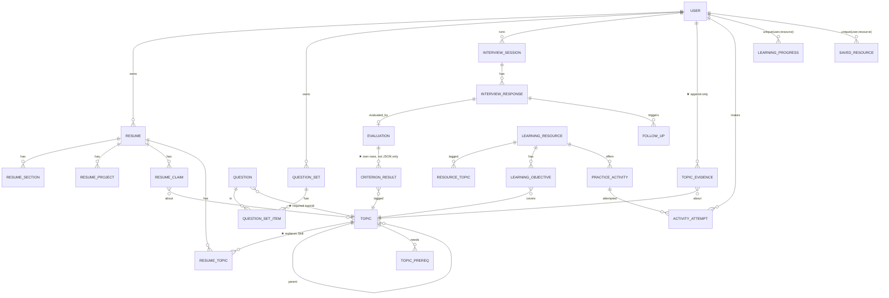

# ResumePilot — Architecture

## 1. Stack (proposed; confirm in MEMORY.md decisions)
Next.js (App Router) · TypeScript strict · Tailwind · PostgreSQL + Prisma · Zod · Auth.js (single provider first) · Vitest (unit/integration) · Playwright (e2e). Modular monolith. No extra DB/queue/vector store.
LLM access only via `LlmGateway` interface (provider TBD — Open Question OQ-1).

## 2. Layering and import rules
```
app/ (routes, RSC, route handlers)  → validates input (Zod), authn, calls →
modules/<m>/services                → business rules, transactions, calls →
modules/<m>/repositories            → Prisma only here
shared/{auth,database,validation,errors,logging,security,llm}
```
Rules (enforce with eslint `no-restricted-imports`):
1. UI never imports repositories or Prisma.
2. A module never imports another module's repositories. Cross-module needs go through `modules/evidence/service` (the only shared domain service) or typed IDs.
3. Deterministic logic lives in pure functions under `*/domain/` with no I/O (score aggregation, gap rule, status transitions, progress, attempt numbering).
4. LLM output is untrusted: parse → Zod → domain validation → persist.

Folder sketch (create only when used):
```
src/modules/{resume,interview,library,evidence}/{schemas,services,repositories,domain}
src/shared/llm/{gateway.ts,prompts/,schemas/}
```

## 3. Canonical data model (changes from original are marked ★)


### Changes to original entities
- ★ **Topic** is the only taxonomy (`slug` unique, `parentTopicId`, `category`). `Skill`/`ResumeSkill` become `ResumeTopic{resumeId, topicId, sourceSectionId, sourceClaimId?, proficiencyDeclared?, userConfirmed}`. Unknown skills from a resume create a `Topic` with `status=candidate` (not shown in library until curated).
- ★ **Question.topicId NOT NULL**; add `comparabilityKey` (text), `rubricId`+`rubricVersion`, `claimTextSnapshot` (for defense questions; claims can be edited later).
- ★ **CriterionResult** table: `evaluationId, criterionId, topicId, objectiveId?, score, maxScore, evidenceQuote?, feedback`. Evaluation keeps `rubricVersion`, `explanation`, `uncertaintyNotes`, `status`.
- ★ **TopicEvidence**: `id, userId, topicId, sourceType('interview_criterion'|'activity_attempt'), sourceId, criterionId?, ratio (0..1, = score/max), comparabilityKey, rubricVersion, observedAt`. No updates/deletes except user data deletion. Unique `(sourceType, sourceId, criterionId)` for idempotency.
- **ResumeClaim**: as original, plus `quoteText` and offsets **computed by app**; unique `(resumeId, sourceStartOffset, sourceEndOffset, claimType)`.
- **UserObjectiveProgress**: NOT created. Objective status derived from evidence + attempts.
- **Resume versioning**: new upload creates version+1, previous `isActive=false` (partial unique index: one active per user).
- Everything else (Resume, ResumeSection, ResumeProject, QuestionSet, InterviewSession, InterviewResponse, FollowUp, LearningResource, ResourceTopic, LearningObjective, PracticeActivity, ActivityAttempt, LearningProgress, SavedResource, Prerequisite) follows the original spec fields. Add check constraints: topic≠prereq, attemptNumber>0, `0≤score≤maxScore`.

Indexes: all FKs; `(userId, topicId, observedAt desc)` on evidence; `(userId, activityId, attemptNumber)` unique; `(resourceId)` on objectives/activities.

## 4. State machines (pure functions + tests)
- Resume extraction: `uploaded → extracting → extracted | failed_unreadable | failed_error` → `review_pending → confirmed`.
- Session: `draft → in_progress ⇄ paused → completed | abandoned`.
- Response evaluation: `submitted → pending → completed | failed | inconclusive`; `failed → pending` (retry, max 3).
- Attempt: `in_progress → submitted → passed | needs_review | evaluation_failed`.
- Learning progress derived: `not_started → in_progress (first attempt/start) → submitted → passed → completed (policy met)`. `needs_review` when latest attempt failed policy.

## 5. Evaluation pipeline
```
Response → eligibility check (non-empty, owned, not already completed)
 → Evaluator by answerFormat:
     deterministic (MCQ/exact) → code scores
     rubric-LLM → prompt(rubric, expectedConcepts, response as DATA) → JSON
 → Zod parse → domain validate (criterion ids ⊆ rubric, 0≤score≤max, evidence quote ⊆ response)
 → if invalid after 1 repair retry → status=inconclusive (never invented score)
 → total = Σ scores (code) → persist Evaluation + CriterionResults + TopicEvidence in one transaction
```
Optional `samples=2` self-agreement for rubric-LLM; disagreement beyond tolerance → `inconclusive`.

## 6. Resume pipeline
```
file → type/size/magic-byte check → extract text (library chosen at impl; verify maintained)
 → empty/garbled heuristic → failed_unreadable
 → LLM structuring (text wrapped as untrusted data; JSON only) → Zod
 → for each claim: find quote in text (exact, whitespace-normalized) → offsets or discard
 → map skills to Topic (slug/alias table; unknown → candidate)
 → persist as unconfirmed → user review → confirmed
 → delete uploaded file buffer (never written to disk/object store)
```

## 7. LLM gateway
`complete({task, system, input, schema, maxTokens, timeoutMs}) → {ok:true,data}|{ok:false,reason}`. Prompts versioned in `shared/llm/prompts/`. Provider response shapes never leave the gateway. Per-user rate limit. Redacted logging: task name, latency, token counts, status — never content.

## 8. Security
- Auth middleware + per-query `where userId` in repositories (repository methods take `userId` mandatory param).
- Upload: size cap, MIME + magic bytes, memory processing only.
- Code answers: stored as text, never executed.
- Headers/CSP, CSRF via framework defaults, secrets in env, `.env.example` placeholders only.
- Delete flows cascade; `TopicEvidence` deletion on user delete.

## 9. Observability
Structured logs (no content), request id, error codes. Product metrics via counts from DB, not third-party trackers in v1.

## 10. ADR index (record in MEMORY.md)
ADR-1 Topic replaces Skill · ADR-2 Evidence ledger · ADR-3 App-computed offsets · ADR-4 One session engine · ADR-5 No code execution v1 · ADR-6 Prisma+Postgres · ADR-7 Derived objective progress.
