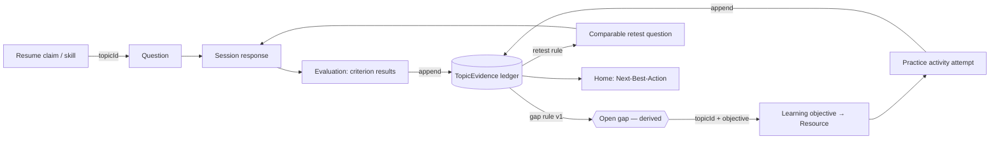

# ResumePilot — Blueprint

**Promise:** *Know what your resume invites an interviewer to ask. Practise defending it. Fix what you can't yet explain.*

## 1. What I changed vs. the original spec (and why)

The original spec has three modules linked by prose. The weakest point: **each module has its own vocabulary** (`Skill` on resumes, `Topic` in the library, `topicId` nullable on questions), so "gap → resource" has no reliable join key. Fixes:

| # | Problem in original | Improvement | Effect |
|---|---|---|---|
| 1 | Skill ≠ Topic; Question.topicId nullable | **One canonical `Topic` taxonomy** is the join key for claims, questions, rubric criteria, objectives, resources, activities. `Skill` is removed; a resume skill = a `ResumeSkill → Topic` link. | Gap→resource matching becomes a deterministic query, not an LLM guess. |
| 2 | "Gap" / "improvement" are vague, risk being invented | **Append-only `TopicEvidence` ledger.** Every evaluated interview criterion and every activity attempt appends rows (topic, source, ratio, rubric version, time). Gaps, progress, and "improved?" are *derived by versioned rules* from it. | Single source of truth; traceable; no fabricated progress. |
| 3 | Rubric criteria have no topic link | Each rubric criterion carries `topicId` (+ optional `objectiveId`). | Criterion-level gaps ("explained trade-offs poorly on *Redis caching*") map to exact objectives. |
| 4 | Improvement claimed without comparison | **Retest loop** with `comparabilityKey` (topic + rubric family + difficulty). Before/after shown only when comparable evidence exists, displayed as raw n and ratios, never "+X% mastery". | Honest evidence of improvement. |
| 5 | LLM could supply claim offsets / scores | **LLM proposes quotes; app computes offsets** (exact-match against extracted text; reject if not found). **LLM proposes criterion scores; app validates bounds and sums.** | Source traceability and score integrity enforced in code. |
| 6 | Resume text is untrusted but fed to a model | Prompt-injection stance: resume = data, never instructions; model has **no tools**; outputs schema-only. | Security. |
| 7 | Mode A/B/C as three engines | **One session engine**, `sessionType ∈ {defense, challenge, mock}`. Mock = sequence of A+B items. | Less code, one state machine. |
| 8 | Everything depends on a resume | **Library works standalone** (cold start) + 5-question diagnostic produces evidence without a resume. | Product useful on day 0. |
| 9 | Home page stats | **Next-Best-Action** card computed by deterministic rules (no LLM). | Real, explainable guidance. |
| 10 | Many activity/challenge types | MVP exposes only types with working evaluation (see §5). | Matches "no empty options" principle. |
| 11 | Library content source unspecified | **Curated seed content, link-out + original short notes**; knowledge checks are deterministic (MCQ), graded in code. | Objective evaluation separated from LLM-rubric evaluation. |
| 12 | Privacy of gap→library handoff | Handoff payload = `{topicId, criterionIds, evidenceIds}` only. Answer text never travels. | Matches spec principle. |

## 2. The spine (how the three modules connect)

Everything reads/writes through `Topic` and `TopicEvidence`. Modules never call each other's repositories; they call a small **Evidence service**.

## 3. Primary user flows

**Flow 1 — Resume → Practice (hero path)**
Upload → extract → review claims (confirm/edit/exclude) → pick target role → generate question set → start session → answer → see criterion breakdown → follow-up (traceable) → session report.

**Flow 2 — Gap → Learn → Retest (the loop)**
Session report shows "Topics to revisit" (derived gaps, with evidence links) → open matching resource/objective → start activity → attempt evaluated → evidence appended → "Retest this topic" → comparable question → before/after evidence view.

**Flow 3 — Cold start (no resume)**
Library → pick topic → 5-question diagnostic (deterministic) → evidence → recommended resource → activity.

**Flow 4 — Return visit**
Home shows exactly one primary action (resume session / review claims / revisit gap / retest), with a "why" line citing real records.

## 4. Gap & retest rules (v1, configurable constants, versioned)

- **Observation:** any single evidence row. Shown as "last attempt", never called a gap.
- **Open gap(topic):** ≥2 interview-source evidence rows for the topic where the latest 2 each have ratio < `GAP_THRESHOLD` (0.6), and no later passing evidence (ratio ≥ 0.7 on a comparable item). `gapRuleVersion` stored with any displayed gap.
- **Retest eligible:** an activity for the topic reached `passed` after the gap opened.
- **Improvement shown:** ≥1 pre-gap and ≥1 post-activity comparable evidence row. Displayed as "2 earlier answers: 0.4, 0.5 → 1 retest: 0.75".
- Constants live in one file, are unit-tested, and changes bump the version.

## 5. Scope for first release (vertical slice)

| Area | In MVP | Deferred (documented, not stubbed in UI) |
|---|---|---|
| Resume | PDF/DOCX/paste-text, claim review | OCR for scans (explicit "unreadable" state instead) |
| Interview | defense, mock; challenge = conceptual + code-explanation; follow-ups | code execution sandbox (no execution; code *review* only, labelled) |
| Library | knowledge_check (deterministic), short_answer (LLM-rubric) | debugging, implementation_task, design_exercise |
| Auth | single provider, ownership checks everywhere | multi-provider |
| Cross-module | ledger, gap rule, retest, home NBA | objective-level progress table (derive instead) |

## 6. Module map

| Module file | Owns |
|---|---|
| `modules/00-foundation.md` | Repo, shell, design system, DB, auth, errors, LLM gateway |
| `modules/01-resume-intelligence.md` | Upload→claims→question-set context |
| `modules/02-interview-lab.md` | Sessions, evaluation, follow-ups |
| `modules/03-tech-library.md` | Topics, resources, activities, attempts, progress |
| `modules/04-evidence-loop.md` | Ledger, gap rule, retest, home NBA — **the connector** |
| `modules/05-quality-hardening.md` | Security, tests, responsive QA, docs |

## 7. Build order
00 → 01 → 02 → 03 (can start after 00, parallel to 01/02 by a second agent) → 04 → 05. First demoable slice = 00+01+02+04(ledger only) → then 03 → loop closes in 04.
